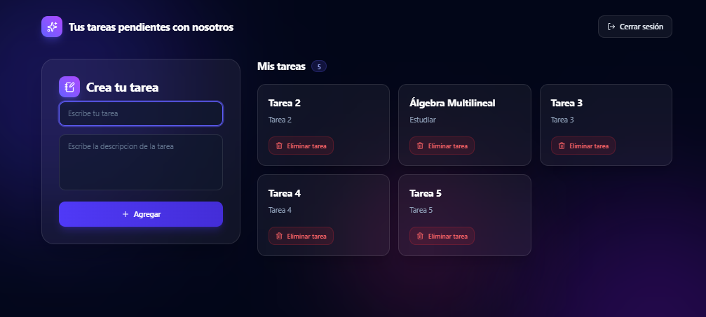

📋 Gestor de Tareas Pendientes

Aplicación web para registrar usuarios, iniciar sesión y administrar tareas pendientes. Está construida con React, usa Firebase (Authentication y Firestore) como backend y Tailwind CSS con íconos de Lucide para la interfaz.

✨ Características
Registro de usuarios con nombre de usuario, correo y contraseña.

Inicio y cierre de sesión con Firebase Authentication.

Creación de tareas con título y descripción.

Listado de tareas con contador y estado vacío ("No hay tareas aún").

Eliminación de tareas.

Persistencia de datos en Cloud Firestore.

Recuerda la última pantalla visitada mediante localStorage.

Manejo de errores de registro (correo duplicado, contraseña débil, correo inválido).

Protección contra doble envío en los formularios.

Link de la pagina: https://rusbelj.github.io/react-Agenda-de-tareas/